# Card styles

Choose **Settings → Appearance → Card Settings**. These examples come directly from the shipped local SVG renderer, with sample cover art for Studio, Editorial and Hi-Fi. Local cards show your server's cover or poster. Hosted README cards can include sanitized artwork when **Include cover art** is enabled; detailed episode metadata stays local.

## Classic

A familiar dark card with blue progress.

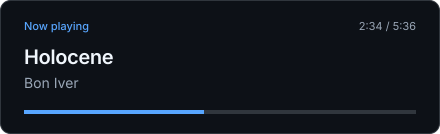

## Paper

White background, clear dark text.

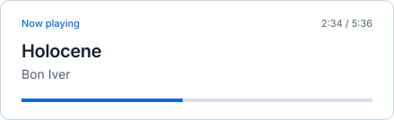

## Studio

Full-bleed artwork under a dark cinema shade, a framed cover and a two-line title.

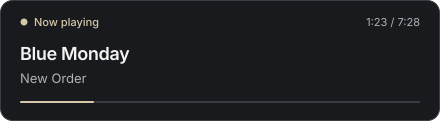

## Editorial

A large cover, serif title, warm paper and a perforated sleeve seam.

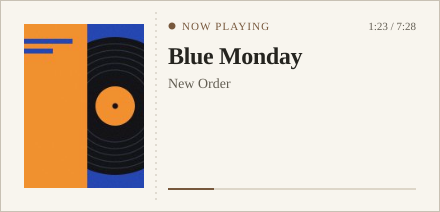

## Hi-Fi

Monospace type with a muted green palette.

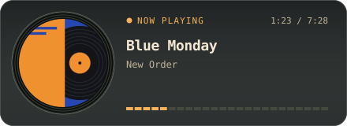

## Compact

Just the title, without artwork or progress by default.

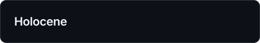

## Other playback states

| State | Example |
| --- | --- |
| TV episode | 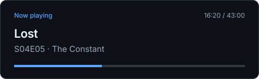 |
| Film | 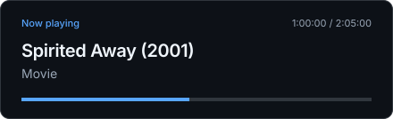 |
| Paused | 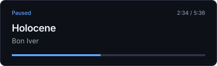 |
| Nothing playing | 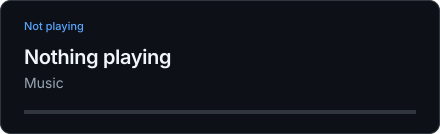 |
| Titles hidden | 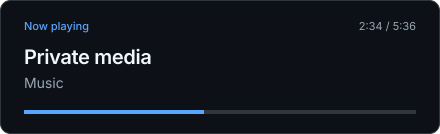 |

Hiding a whole media type shows the idle state. Hiding progress also removes the timer. Privacy applies before any appearance choices.

See [customization](customization.md) for layout controls and theme names. After changing a saved style, copy the new hosted README snippet to update an existing embed.

For contributors: `node scripts/render-card-examples.js` regenerates these images. The example test checks that they match the renderer; visual fixtures also cover narrow cards, artwork, RTL and reordered fields.
