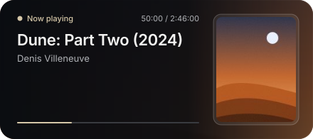
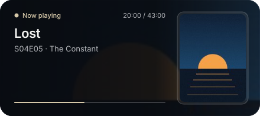
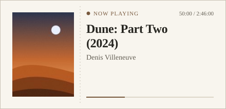
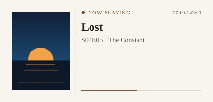
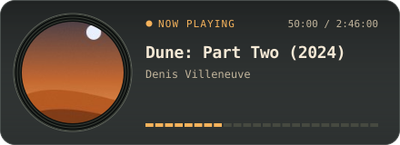
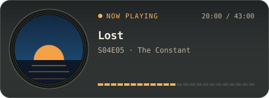

# Card styles

Six styles, one live card. Choose **Settings → Appearance → Card Settings**, select a style and press **Save**. These examples are generated by the app's SVG renderer using illustrated sample artwork. During playback, the app uses your actual album cover or poster.

[Studio](#studio) · [Editorial](#editorial) · [Hi-Fi](#hi-fi) · [Classic](#classic) · [Paper](#paper) · [Compact](#compact)

## Studio

Artwork fills the background beneath a dark cinema shade. A framed cover sits on the right, with room for a two-line title on the left.

**Music**

**Film**

**TV**

## Editorial

Warm paper, a large cover and serif titles give this style a printed sleeve feel. A perforated seam separates the artwork from the playback details.

**Music**

**Film**

**TV**

## Hi-Fi

A record display with circular artwork and grooves, monospace type and an amber segmented timeline. Its theme value remains `terminal` for existing card links.

**Music**

**Film**

**TV**

## Classic

A dark card with blue progress.

**Music**

**Film**

**TV**

## Paper

White background and clear dark text.

## Compact

Just the title, without artwork or progress by default.

## Use a style in your README

After saving your appearance, open **Sharing → Hosted Card Settings**. Enable uploads and, to show album covers and posters, **Include cover art**, then save. Copy the README snippet into your profile or repository. After an appearance change, copy it again: the style and layout are part of the image URL. See [Add a README card](wiki/Add-a-README-card.md) for the full setup.

The gallery above shows local cards. Hosted cards use the same styles, but detailed season and episode numbers stay on your PC. Cover sharing sends a small sanitized image; it never sends the original artwork URL. **Hide artwork** and **Hide titles** override cover sharing. If artwork is unavailable, the card still shows the playback text.

## Other playback states

| State | Example |
| --- | --- |
| Paused |  |
| Nothing playing |  |
| Titles hidden |  |

Hiding a whole media type shows the idle state. Hiding progress also removes the timer. Privacy applies before appearance choices.

See [customization](customization.md) for width, typography, artwork size and layout controls.

For contributors: `node scripts/render-card-examples.js` regenerates these images. `node --test test/card-examples.test.js` checks that every committed example matches the renderer. Visual fixtures also cover narrow cards, artwork, RTL and reordered fields.
